<!-- Every image here is an animated SVG drawn by the scripts in scripts/.
     The heatmap and activity chart refresh daily via .github/workflows/update-profile-art.yml.
     Keep images that sit side by side on one line with no spaces between them. -->

 
 
 
 
 
 

<a href="https://raiyaan-eight.vercel.app">portfolio</a> &nbsp;/&nbsp; <a href="https://linkedin.com/in/abdulraiyaan">linkedin</a> &nbsp;/&nbsp; <a href="mailto:raiyaantopas@gmail.com">email</a>

